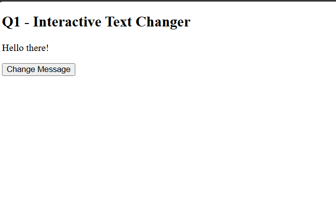
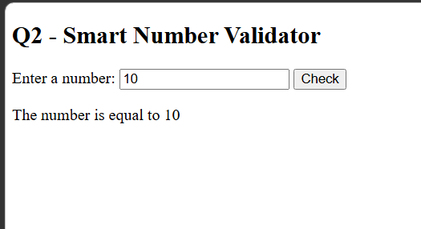
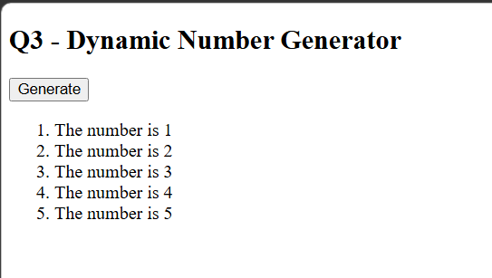

# BIC21203 Lab 4a - JavaScript

**Name:** Tan Zhuo You
**Student ID:** AI240173

## Explanation

Three small web pages using plain JavaScript (no libraries):

- **Q1** - Clicking "Change Message" changes the paragraph to "Hello there!".
- **Q2** - Checks if the input number is lower, higher or equal to 10. Empty or non-number input shows "Please enter a valid number!".
- **Q3** - Clicking "Generate" uses a for loop to create a list from "The number is 1" to "The number is 5". The list is cleared first so it never duplicates.

## How to Run

Open the `index.html` file inside each folder in a web browser:

- `Q1/index.html`
- `Q2/index.html`
- `Q3/index.html`

## Screenshots

### Q1

### Q2

### Q3

